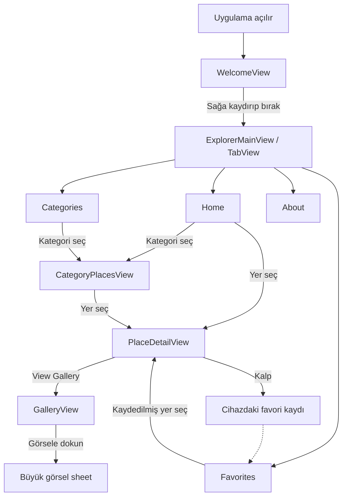

# Istanbul Explorer — projeyi öğrenme ve sunum raporu

Bu rapor, 13 Kasım 2026 tarihinde depoda bulunan kodu açıklar. Amaç, projeyi ilk kez gören bir öğrencinin ekranları, veri akışını ve temel SwiftUI kavramlarını anlayabilmesidir. Kodda bulunmayan bir özellik uygulanmış gibi anlatılmaz. Bu belge hazırlanırken iOS derlemesi veya cihaz testi yapılmamıştır.

## 1. Uygulama ne yapıyor?

Istanbul Explorer, İstanbul'daki bazı turistik yerleri tanıtan bir iOS uygulamasıdır. Kullanıcı hareketli bir karşılama ekranından girer, yerleri kategoriye göre gezer, açıklamalarını okur, görsellere bakar ve sevdiği yerleri favorilere ekler.

Bu sürümde rota hesaplama, harita, mesafe bulma, konum izni, üyelik, reklam, sunucu veya internetten veri indirme yoktur. Yer bilgileri ve görseller uygulamanın içindedir. Favoriler aynı cihazda saklanır; hesaplar veya cihazlar arasında eşitlenmez.

Uygulama sekiz ana ekran türünü içerir. Birden fazla yerin aynı detay şablonunda açılması, her yer için ayrı Swift dosyası yazıldığı anlamına gelmez.

## 2. Önce hangi sırayla okuyalım?

1. `IstanbulExplorerApp.swift`: uygulamanın nerede başladığını öğrenin.
2. `SlideToExplore.swift` ve `WelcomeView.swift`: giriş işlemini takip edin.
3. `ExplorerMainView.swift`: dört sekmeyi ve ekran geçişlerini anlayın.
4. `ExplorerPlace.swift`: ekranların hangi veriyi kullandığını görün.
5. `ExplorerHomeView.swift`, `CategoriesView.swift`, `CategoryPlacesView.swift`: verinin nasıl listelendiğini inceleyin.
6. `PlaceDetailView.swift` ve `FavoritesView.swift`: kalıcı favori kaydını takip edin.
7. `GalleryView.swift` ve `ExplorerArtwork.swift`: görsel seçme ve kırpmayı öğrenin.
8. `SunsetScene.swift`, `AboutView.swift`, `AudioGuideView.swift`: animasyonu ve kalan bileşenleri inceleyin.

## 3. Ekran akışı



Sekme değiştirmek ile yeni sayfa açmak farklı işlemlerdir. TabView Home, Categories, Favorites ve About arasında geçiş yapar. NavigationStack ise örneğin Categories → Historical Places → Hagia Sophia sırasını ve geri dönüşü yönetir. Galerideki büyütülmüş görsel, bu yığına yeni sayfa eklemek yerine bir `sheet` olarak sunulur.

## 4. Klasörler ve proje dosyaları

```text
IstanbulExplorer/
├── IstanbulExplorer.xcodeproj/
│   ├── project.pbxproj
│   └── xcshareddata/xcschemes/IstanbulExplorer.xcscheme
├── IstanbulExplorer/
│   ├── 16 adet .swift dosyası
│   └── Assets.xcassets/
├── README.md
├── PROJE_RAPORU.md
├── .gitignore
└── Görsel üretim komutlarını içeren .txt dosyaları
```

`project.pbxproj`, Xcode'un hangi kaynakları derleyeceğini, hangi kaynak dosyalarını paketleyeceğini ve hedef ayarlarını tutar. Dosyayı normalde elle düzenlemek yerine Xcode kullanılır. Bir Swift dosyasının klasörde bulunması tek başına yeterli değildir; uygulama target'ına da bağlı olması gerekir. Bu projede 16 Swift dosyası Sources aşamasına, asset kataloğu Resources aşamasına bağlıdır.

Paylaşılan `IstanbulExplorer.xcscheme`, projeyi başka bir bilgisayarda açan kişinin çalıştırılacak target'ı görebilmesini sağlar. Scheme uygulama kaynak kodu değildir; çalıştırma/derleme düzenidir.

| Ayar | Mevcut değer ve anlamı |
|---|---|
| Minimum iOS | 17.0; daha eski cihaz sürümleri hedeflenmiyor |
| Swift dil modu | Proje ayarında 5.0; bilgisayardaki derleyicinin sürümüyle aynı kavram değildir |
| Bundle identifier | `com.istanbulexplorer.IstanbulExplorer`; cihaz imzasında gerekirse benzersiz yapılır |
| Görünen ad | Istanbul Explorer |
| Sürüm / build | 1.0 / 1 |
| Cihaz ailesi | iPhone ve iPad; iPad görünümü ayrıca test edilmedi |
| Signing | Automatic; fiziksel cihazda kendi Team hesabınız gerekir |
| Info.plist | Xcode tarafından üretiliyor; ayrı bir dosya tutulmuyor |
| Paket bağımlılığı | Yok; SlideButton kaldırıldı |

Debug ayarı geliştirme için optimizasyonu kapatır (`-Onone`); Release ayarı optimizasyon kullanır (`-O`). Depoda bulunması App Store'a hazır veya mağazada yayımlanmış olduğu anlamına gelmez. Uygulama simgesi ve mağaza teslim hazırlıkları da ayrıca yapılmalıdır.

`.gitignore`, DerivedData, build, kullanıcıya özel Xcode dosyaları, imza dosyaları ve `.env` gibi dosyaların yanlışlıkla Git'e eklenmesini azaltır. İmzalama dosyası veya parola uygulamanın kaynak kodu değildir. `.txt` görsel komutları ise görsellerin nasıl üretildiğini kayıt altında tutar; uygulama bunları okuyup kullanmaz.

## 5. Swift sözdizimini okumak

| Kod | Bu projede ne demek? |
|---|---|
| `import SwiftUI` | Arayüz bileşenlerini ve SwiftUI altyapısını kullanabilmek |
| `struct X: View` | Arayüz üreten bir değer türü; ekranların çoğu böyle tanımlanır |
| `var body: some View` | Bu bileşenin hangi arayüzü oluşturduğunu tarif eder |
| `let` / `var` | Değiştirilmeyen değer / değiştirilebilen değer |
| `private` | O üyenin kullanımını bulunduğu kapsamla sınırlar |
| `static let` | Tek bir ekran örneğine değil, türün kendisine ait sabit veri |
| `@State` | Ekranın yönettiği değişebilir durum; değişince ilgili görünüm güncellenir |
| `$query` | Değerin kendisi değil, okuma ve yazmaya izin veren Binding bağlantısı |
| `@Environment` | Hareketi Azalt veya scenePhase gibi üst ortam değerlerini okumak |
| `@AppStorage` | Küçük bir değeri UserDefaults üzerinden kalıcı saklamak |
| `() -> Void` | Parametre almayan ve sonuç değeri döndürmeyen işlem tipi |
| `{ ... }` | Closure; bir yere parametre olarak verilen çalıştırılabilir kod bloğu |
| `Photo?` | Photo veya nil olabilen optional değer |
| `$0` | Kısa closure içindeki ilk parametre |
| `condition ? a : b` | Koşul doğruysa a, yanlışsa b seçmek |
| `guard ... else { return }` | Şart sağlanmıyorsa fonksiyondan erken çıkmak |
| `filter` | Koşulu sağlayan öğelerden yeni dizi oluşturmak |
| `map` | Öğeleri başka değerlere dönüştürmek |
| `contains` | Bir öğenin bulunup bulunmadığını kontrol etmek |

Ekranların struct olması eksiklik değildir. SwiftUI'da görünüm tanımlamak için normal bir yaklaşımdır. Burada ayrıca ViewModel, veritabanı katmanı veya servis sınıfları kurulmamıştır. Küçük kapsam nedeniyle veriler bir model dosyasında, kısa işlemler ilgili View içinde tutulur. Bu yapıyı tam bir MVVM mimarisi olarak sunmamak gerekir.

`body`, ekrana bir kere çizgi çizip bitiren bir fonksiyon gibi düşünülmemelidir. Mevcut durumun nasıl görünmesi gerektiğini tarif eder; durum değişince SwiftUI gerekli görünüm güncellemelerini yapar. Bu nedenle `body` içinde ağ isteği veya kalıcı kayıt gibi yan etkiler başlatmıyoruz.

## 6. Başlangıç: IstanbulExplorerApp.swift

`@main`, uygulamanın başlangıç noktasını belirtir. Yapı `App` protokolüne uyar; `WindowGroup` içinde ana içerik oluşturulur.

`isExploring` başlangıçta false'tur. False olduğunda WelcomeView, true olduğunda ExplorerMainView gösterilir. WelcomeView'a verilen `{ isExploring = true }` closure'ı giriş tamamlandığında çalışır.

Bu bilgi `@State` olduğu için diske yazılmaz. Süreç gerçekten kapanıp yeniden başladığında karşılama tekrar gelir. Yalnızca uygulamayı arka plana atmak her zaman yeni bir başlangıç demek değildir. Bu bir oturum açma sistemi değildir; kullanıcı adı veya parola kontrolü yapılmaz.

## 7. Karşılama: WelcomeView.swift

`ZStack` üç katmanı üst üste yerleştirir: manzara, karartma geçişi ve kontroller. `VStack`, başlığı, ortadaki oynatma kontrolünü ve alttaki giriş alanını dikey dizer. `Spacer` boş alanı paylaşır.

`isPlaying`, ortadaki düğmeye basılınca `toggle()` ile true/false arasında değişir ve SunsetScene'e aktarılır. `reduceMotion`, iOS'un Hareketi Azalt ayarını okur; açıksa oynatma kontrolü gizlenir. Manzara tarafında da hareket azaltılır.

`onExplore` WelcomeView'ın sahip olduğu uygulama durumunu değiştirmez; üstten gelen işlemi SlideToExplore'a iletir. Böylece kaydırıcı, ana ekranın hangi dosya olduğunu bilmek zorunda kalmaz.

`ignoresSafeArea`, arka planın ekran kenarlarına uzanmasını sağlar. Kontroller ise normal VStack yerleşimi içinde kalır. Başlığın beyaz olması için bu ekranda koyu renk düzeni seçilmiştir; ana uygulama açık düzene döner.

## 8. Kaydırarak giriş: SlideToExplore.swift

Bu bileşen özel bir sürükleme kütüphanesi kullanmaz. SwiftUI'ın hazır `Slider` kontrolü, turuncu bir Capsule arka planına yerleştirilmiştir.

`position` 0.0 ile başlar; Slider aralığı `0...1`'dir. `$position` sayesinde sürükleme konumu ekrandaki State değerine yazılır. `onEditingChanged`, işlem başlarken true, biterken false ile `finishSlide` fonksiyonunu çağırır.

Fonksiyonun sırası:

1. Düzenleme sürüyorsa `guard !isEditing else { return }` ile çık.
2. Kullanıcı bıraktığında değer en az 0.9 ise `onExplore()` çağır.
3. Daha azsa `position = 0` ile kaydırıcıyı başa al.

Bu nedenle sadece sağa yaklaşmak değil, kaydırmayı bırakmak da gerekir. Başlangıca dönüşte ayrıca bir animasyon tanımlanmamıştır. Sağ yön, `layoutDirection` ile sabitlenmiştir. Erişilebilirlik için label, hint ve giriş işlemini çağıran accessibility action eklenmiştir; bu eylem kaydırmayı zorunlu kılmadan giriş sağlayabilir. Bileşen güvenlik kilidi değildir.

## 9. Hareketli arka plan: SunsetScene.swift

Bu dosya gerçek video oynatmaz. `BosphorusSunset` görselini çok az büyütüp yana kaydırarak hareket hissi oluşturur.

`GeometryReader`, ekranda kullanılabilecek boyutu verir. `TimelineView`, animasyon etkinse zaman ilerledikçe içerik hesabını yeniler. Minimum güncelleme aralığı 1/24 saniyedir; bu, cihazın kesin olarak saniyede 24 kare göstereceği garantisi değildir.

Animasyon ancak `isPlaying && !reduceMotion && scenePhase == .active` ise düzenli güncellenir. Böylece durdurma düğmesi, erişilebilirlik ayarı ve uygulamanın etkinliği dikkate alınır.

Hesaplar:

```text
seconds = mevcut zamanın referans tarihten itibaren saniyesi
angle   = (seconds mod 12) × 2π / 12
scale   = 1.045 + 0.018 × cos(angle)
drift   = 3 × sin(angle)
```

Hareket azaltma kapalıyken ölçek yaklaşık 1.027–1.063 arasındadır; yatay hareket yaklaşık -3 ile +3 point arasındadır. Sinüs ve kosinüs, döngünün uçlarında sert bir sıçrama yerine yumuşak değişim verir. Hareketi Azalt açıkken ölçek 1, kayma 0 olur.

Zaman, birikimli oynatma süresinden değil gerçek saatten alındığı için duraklatmadan devam edildiğinde o anki faza geçilir; video oynatıcı gibi tam durdurulan saniyeden sürdürme yoktur. `clipped`, görüntünün kendi çerçevesi dışına taşmasını keser.

## 10. Sekmeler: ExplorerMainView.swift

`TabView`, Home, Categories, Favorites ve About için native iOS sekme çubuğunu oluşturur. Elle HStack içine dört buton konmamıştır. `.tabItem` her sekmenin başlığını ve SF Symbol simgesini tanımlar.

Home ve Categories, kategori veya yer değerlerini alabilecek navigation destination tanımlar. Favorites yalnızca yer detayına gider; About statik tanıtımdır. Her sekmenin ayrı NavigationStack'i bulunur.

İki farklı NavigationLink biçimi vardır:

```swift
NavigationLink(value: place) { /* kart görünümü */ }
// ExplorerMainView'daki navigationDestination(for: ExplorerPlace.self) hedefi seçer.

NavigationLink { GalleryView() } label: { /* düğme görünümü */ }
// Hedef doğrudan bu bağlantıda tanımlanır.
```

Değerle gezinme için modeller Hashable'dır. Tüm uygulama adına tutulan ayrı bir NavigationPath değişkeni yoktur; geçişleri NavigationStack yönetir. `.toolbarBackground(.hidden, for: .tabBar)`, çubuğun arka planını gizler; ikonları ve dokunma alanlarını kaldırmaz. Alttan görünen renk ilgili ekranın zeminidir. Gerçek cihazdaki son görünüm henüz doğrulanmamıştır.

## 11. Veriler: ExplorerPlace.swift

`ExplorerCategory`, üç seçenekli bir enum'dır: historical, nature ve museums. String ham değerleri ekranda görünen İngilizce başlıklardır. `CaseIterable` sayesinde `allCases` ile tüm kategoriler listelenir. `Identifiable` için `id` kategorinin kendisidir. `coverPhoto`, `icon` ve `color` hesaplanan özellikleri kartların görünümünü belirler.

`ExplorerPlace`, yerin name, summary, location, guide, categories ve photo bilgilerini taşır. Buradaki location koordinat değil, ekranda gösterilen metindir. categories dizi olduğu için bir yer birden fazla kategoride bulunabilir.

| Yer | Kategori | Görsel numarası |
|---|---|---:|
| Hagia Sophia | Historical Places | 1 |
| Topkapı Palace | Historical Places, Museums | 3 |
| Blue Mosque | Historical Places | 4 |
| Galata Tower | Historical Places | 0 |
| Maiden’s Tower | Historical Places, Nature & Views | 5 |
| Bosphorus Bridge | Nature & Views | 2 |

`all` bu altı kaydı, `popular` yalnızca Hagia Sophia ve Galata Tower'ı içerir. Museums listesinin bu sürümde tek kaydı Topkapı Palace'tır. Galerideki on görselin tamamı ayrı bir gezilecek yer kaydı değildir.

`id`, yerin isminden üretilir. Basit ve okunur bir çözümdür; fakat aynı isimle iki yer eklenmemeli, bir yerin adı değiştirilince eski favori kaydının eşleşmeyebileceği bilinmelidir. Uygulama büyürse isimden bağımsız sabit kimlik kullanmak daha uygundur.

## 12. Ana ekran: ExplorerHomeView.swift

Üç State değeri vardır: `showSearch` arama kutusunu, `query` yazılan metni, `showAll` tüm yerlerin gösterilip gösterilmeyeceğini tutar. `cream` ve `navy` tekrar kullanılan sabit renklerdir.

`visiblePlaces` hesaplanan özelliği, sorgunun başındaki ve sonundaki boşlukları temizler; isimlerde `localizedStandardContains` ile eşleşme arar. Boş aramada başlangıçta iki popüler yer görünür. See all seçildiyse veya arama metni varsa eşleşen ana liste kullanılır. Sonuç yoksa açıklama yazısı gösterilir. İnternette veya konumlarda arama yapılmaz.

Arama düğmesi alanı açıp kapatır; kapatınca metin temizlenir. TextField `$query` ile bağlıdır, ayrı bir arama tuşu gerektirmez. See all / Show less yalnızca `showAll` değerini değiştirir. İçerik, `header`, `hero` ve `popularPlaces` adlı küçük görünüm parçalarına ayrılarak body kısaltılmıştır.

Hero görselinde koyu bir LinearGradient üstüne yazı konur. Kartlarda iki esnek sütunlu LazyVGrid kullanılır. Kartlar doğrudan ilgili ExplorerPlace değerini gönderir. `maxWidth: 500` geniş ekranlarda içeriğin aşırı yayılmasını sınırlar; sonraki sonsuz genişlikli frame içeriği alan içinde ortalar.

## 13. Kategori kartları ve yer listesi

`ExplorerCategoryCards.swift`, ana ekrandaki küçük ve renkli üç karttır. `Array(repeating: GridItem(.flexible()), count: 3)` mantığı üç esnek sütun oluşturur. Kartlar enum'un ikon, renk ve başlığını kullanır.

`CategoriesView.swift`, aynı veriyi büyük görselli kartlarla gösterir. ForEach, `ExplorerCategory.allCases` üzerinde dolaşır. Alt kısımdaki koyu geçiş, beyaz başlığın görsel üzerinde okunmasına yardımcı olur. Kartın sonundaki ok sadece simgedir; geçişi NavigationLink yapar.

`CategoryPlacesView.swift`, önceki ekrandan `let category` ile seçimi alır. `ExplorerPlace.all.filter { $0.categories.contains(category) }` ifadesi sadece o kategoriye ait yerleri bırakır. List her yeri küçük görsel, başlık ve özetle gösterir. Satıra basınca aynı yerin detayı açılır.

List'in varsayılan zemini `scrollContentBackground(.hidden)` ile gizlenir ve krem zemin kullanılır. Liste satırındaki HStack yalnızca görsel ile yazıyı yatay dizer; alt sekmeleri yöneten özel bir buton çubuğu değildir.

## 14. Detay: PlaceDetailView.swift

Bu ekran `let place` ile bir ExplorerPlace alır. Hangi ekrandan gelirse gelsin aynı şablon kullanılır: büyük görsel, isim, konum metni, rehber açıklaması, pasif ses kontrolü ve galeri bağlantısı.

Sağ üstteki kalbin dolu olup olmadığını `isFavorite` hesaplar. `toggleFavorite`, mevcut kimlik dizisinin bir kopyasını alır; yer kayıtlıysa çıkarır, değilse ekler. Sonra diziyi metne çevirerek AppStorage'a yazar. Gerçek konum gösterimi veya navigasyon başlatılmaz; konum yanındaki simge sadece bir Label parçasıdır.

Galeri bağlantısı `GalleryView()` açar. Yer parametresi geçilmediği için her detaydan aynı İstanbul galerisine ulaşılır; yalnızca o yere ait bir albüm açıldığı söylenmemelidir.

## 15. Favoriler nasıl saklanıyor?

Detay ve favoriler ekranında şu satırın anahtarı aynıdır:

```swift
@AppStorage("favoritePlaceIDs") private var savedFavorites = ""
```

`@AppStorage`, varsayılan UserDefaults deposundaki bir değeri arayüze bağlar. İlk kayıt yoksa boş metin kullanılır. Uygulama kapansa da değer kalır; uygulamanın silinmesiyle yerel verinin kaybolabileceği unutulmamalıdır. Bu bir çevrim içi veritabanı veya şifreli kasa değildir.

Örnek akış:

```text
Başlangıç                      ""
Hagia Sophia kalbine bas       "Hagia Sophia"
Galata Tower kalbine bas       "Hagia Sophia|Galata Tower"
Hagia Sophia kalbine tekrar bas "Galata Tower"
```

`split(separator: "|")` metni parçalara ayırır. `map(String.init)` parçaları String'e dönüştürür. `joined(separator: "|")` diziyi tekrar aynı kayıt biçimine getirir. Mevcut yer isimlerinde ayraç yoktur; ileride bir kimlikte `|` kullanılırsa bu basit kayıt biçimi değiştirilmelidir.

`FavoritesView`, kimlikleri okuyup `ExplorerPlace.all` dizisini filtreler. Bu nedenle sıralama favoriye ekleme zamanı yerine ana veri dizisinin sırasına göredir. Kayıtta artık var olmayan bir yer bulunursa listede gösterilmez.

`.onDelete`, List'in native kaydırarak silme işlemini bağlar. Gelen IndexSet ana dizinin değil, o anda görünen favori listesinin indeksleridir. Kod önce bu satırların kimliklerini çıkarır, ardından kayıt metninden o kimlikleri kaldırır. Kullanıcı sadece favori bağlantısını siler; yerin ana veri kaydı silinmez. Hiç kayıt yoksa ContentUnavailableView kullanıcıya kalbi kullanmasını söyler.

## 16. Görseller: ExplorerArtwork.swift ve Assets.xcassets

Asset kataloğunda dört isimli görsel grubu vardır. BosphorusSunset açılışta kullanılır. Diğerleri, birkaç sahnenin aynı PNG dosyasında birleştirildiği koleksiyonlardır:

| Asset | Düzen | Kullanılan numaralar |
|---|---|---|
| ExplorerScenes | 2 sütun × 2 satır | 0 Galata, 1 Hagia Sophia, 2 köprü, 3 Topkapı |
| HistoricalScenes | 2 sütun × 1 satır | 4 Blue Mosque, 5 Maiden’s Tower |
| GalleryScenes | 2 sütun × 2 satır | 6 çarşı, 7 sarnıç, 8 İstanbul Modern, 9 kahvaltı |

ExplorerArtwork, photo numarasından asset adını ve koleksiyon içindeki tile numarasını bulur. `side`, görünümün genişlik ve yüksekliğinin büyük olanıdır. Görsel, her kare side uzunluğunda olacak şekilde büyütülür.

`tile % 2` sütunu; tamsayı bölmesi olan `tile / 2` satırı verir. Örneğin photo 3 için tile 3'tür: sütun 1, satır 1, yani sağ alt kare. photo 5 için HistoricalScenes seçilir, tile 1 olur; sağdaki kare kullanılır.

Offset, koleksiyonu negatif yönde kaydırarak doğru kareyi pencereye getirir. Ek merkezleme terimleri, pencere kare değilse ortadaki kısmın gösterilmesini sağlar. Son `clipped()` pencere dışında kalan koleksiyon parçalarını gizler. Kaynak PNG'den yeni dosya üretilmez.

Bu sistem sadece 0...9 numaralarını bekler; geçersiz numara için ayrı hata görünümü yoktur. Yeni görsel eklemek yalnızca numarayı artırmakla tamamlanmaz: asset seçimi ve kırpma hesabı da güncellenmelidir. Daha büyük bir projede sahneleri ayrı imageset'lere ayırmak bakımı kolaylaştırabilir.

Görseller yapay zekâ ile üretilmiş temsillerdir; gerçek mekân fotoğrafı veya coğrafi doğruluk garantisi değildir. Mevcut galeride on sahne, açılışta ayrıca bir manzara kullanılır. Dört PNG dosyasını veya aynı sahnenin farklı ekranlarda tekrarını 15 ayrı fotoğraf şartı karşılanmış gibi sunmamak gerekir.

## 17. Galeri: GalleryView.swift

Galeri, iki sütunlu LazyVGrid ile on GalleryPhoto kaydını gösterir. Her kayıt sadece id ve title taşır; görseli ExplorerArtwork id üzerinden seçer. Model `private` olduğu için bu dosyanın dışındaki ekranlar tarafından kullanılmaz.

`selected: GalleryPhoto?` başlangıçta nil'dir. Küçük görselin düğmesine basılınca seçilen kayıt atanır. `.sheet(item: $selected)`, bu kayıt olduğu sürece büyük önizleme penceresini sunar. Done düğmesi selected değerini nil yaparak kapatır. Sistem hareketiyle kapatma da sheet akışının parçasıdır.

Küçük resim oranı 1.55, büyük önizleme oranı 1'dir. Bu yüzden küçük görünüm kırpılmışken büyük görünüm daha fazla alan gösterebilir. Önizlemede yakınlaştırma hareketi, fotoğraf indirme, paylaşma veya sonraki görsele kaydırma eklenmemiştir.

## 18. Ses ve tanıtım

`AudioGuideView.swift`, tasarımın ses alanını koruyan bir Button'dır. Action boştur ve `.disabled(true)` etkileşimi kapatır. AVAudioPlayer, AVPlayer, ses dosyası veya gerçek oynatma süresi yoktur. Hocaya bu kontrolün çalışan bir sesli rehber olduğu söylenmemelidir.

`AboutView.swift`, uygulamanın amacını, üç özellik simgesini ve üç kişilik öğrenci ekibi bilgisini gösterir. Ekip üyelerinin isimleri henüz verilmediği için isim veya profil fotoğrafı uydurulmamıştır. feature fonksiyonu aynı biçimdeki üç simge/yazı alanının kodunu tekrar etmemek için kullanılır. Bu ekranda ayrıca görsellerin temsili olduğu ve ses rehberinin ileride ekleneceği açıklanır.

## 19. Tasarım ve erişilebilirlik

Krem zemin, lacivert yazılar ve serif başlıklar Figma'daki sıcak turistik rehber hissini sürdürür. `.padding` iç boşluk, `.frame` boyut, `.clipShape` köşe biçimi, `.background` arka katman, `.overlay` üst katman ekler. Modifier sırası sonucu değiştirir; örneğin padding'den sonra background vermek boşluğu da arka plana dahil eder.

`HStack` yatay, `VStack` dikey, `ZStack` üst üste yerleşimdir. Grid/GridRow ana ekrandaki başlık ve kontrolün hizalanmasını sağlar. LazyVGrid kaydırılan kartlar için esnek sütunlar sunar. SF Symbols, `Image(systemName:)` ile kullanılan sistem simgeleridir; dosya olarak ayrıca indirilmeleri gerekmez.

Anlamlı başlıklar header olarak işaretlenir. Salt görseller `accessibilityHidden(true)` ile tekrar okunmaz; tıklanabilir kart ve düğmelerde isim/etiket bulunur. Hareketi Azalt dikkate alınır. Ancak bu eklemeler tam erişilebilirlik testi yapıldığı anlamına gelmez; VoiceOver ve büyük yazı boyutları gerçek cihazda denenmelidir.

## 20. Mac'te nasıl çalıştırılır?

1. GitHub'dan bu sürümü indirin veya kendi klonunuzda güncelleyin. ZIP indirdiyseniz önce tamamen çıkarın.
2. Eski Xcode penceresini kapatın; yeni klasördeki `IstanbulExplorer.xcodeproj` dosyasını açın.
3. Scheme olarak IstanbulExplorer, hedef olarak iOS 17 veya üzeri bir iPhone simülatörü seçin.
4. Run'a basın. Bu projede üçüncü taraf paket çözümleme adımı olmamalıdır.
5. Gerçek cihazda çalıştıracaksanız target'ın Signing & Capabilities alanından Team seçin; gerekiyorsa bundle identifier'ı değiştirin.

`Unable to resolve module dependency: SlideButton` görülürse önce açık projenin konumunu ve SlideToExplore dosyasını kontrol edin. Güncel dosyada `import SlideButton` bulunmaz; native Slider vardır. Eski proje açıkken yalnızca Clean yapmak yeni kodu getirmez. Doğru sürüm açık olduğu halde eski derleme çıktısı görünüyorsa Xcode'un Clean Build Folder işlemi uygulanabilir.

“Kodlar boş” gibi bir durumda sol menüde Issue Navigator yerine Project Navigator'ı açıp IstanbulExplorer grubundaki Swift dosyalarını seçin. Derleme sorununda sadece “Failed” yazısı yeterli değildir; ilk kırmızı hatanın tam metni incelenmelidir.

## 21. Kontrol durumu ve Mac'te yapılacak testler

Bu değişiklikte yapılan kontrol: yorumlar çıkarıldığında Swift dosyalarının çalıştırılabilir metninin öncekiyle aynı kaldığı karşılaştırıldı. Xcode proje kaynak bağlantıları, kimlik referansları, scheme hedefi ve dört görsel grubunun PNG dosyaları paketleme kontrolünden geçirildi. Bunlar derleme veya ekran davranışı testinin yerine geçmez.

Aşağıdaki tablo **beklenen davranış ve test planıdır; başarılı cihaz testi sonuçları değildir**. Mac'te her satırı deneyip sonuçları ayrıca kaydedin.

| Deneme | Beklenen davranış |
|---|---|
| Uygulamayı yeni başlat | Karşılama görünür |
| Slider'ı yarıda bırak | Giriş açılmaz, konum sıfırlanır |
| Slider'ı %90 veya üzerine çekip bırak | Home açılır |
| Animasyonu durdur / başlat | Düzenli manzara hareketi durur / devam eder |
| iOS Hareketi Azalt açıkken başlat | Sabit manzara, oynatma kontrolü gizli |
| Home'da Galata ara | Eşleşen yer listelenir |
| Olmayan bir isim ara | Sonuç bulunamadı mesajı görünür |
| Aramayı kapat | Metin temizlenir |
| See all / Show less | Altı yer / iki popüler yer görünür |
| Üç kategoriyi tek tek aç | Historical 5, Nature 2, Museums 1 yer gösterir |
| Bir yerin kalbine bas | Kalp dolar, Favorites'ta yer görünür |
| Uygulamayı kapatıp tekrar aç | Favori korunur |
| Favorites'tan detaya girip kalbi kaldır | Yer favori listesinden çıkar |
| Favori satırını sola kaydırıp sil | Sadece o favori kaldırılır |
| Son favoriyi sil | Açıklamalı boş görünüm çıkar |
| View Gallery → görsel → Done | Galeri, büyük önizleme ve kapatma çalışır |
| Farklı yerlerden galeri aç | Aynı ortak galeri görünür |
| Audio düğmesine dokun | Pasif kalır; ses beklenmez |
| Sekme değiştirip geri dön | Gezinme yolları karışmaz |
| Küçük ekran / büyük yazı / VoiceOver | Taşma ve etiketsiz kontrol olup olmadığı incelenir |

Depoda ayrıca bir XCTest target'ı yoktur. Tabloyu tamamlamadan rapora “tüm testler geçti” yazılmamalıdır.

## 22. Küçük değişiklikleri nerede yapacağız?

**Yeni yer:** ExplorerPlace.all dizisine bir kayıt ekleyin; uygun kategoriyi ve mevcut 0...9 aralığından doğru görsel numarasını seçin. Yeni yerin gerçekten farklı görseli gerekiyorsa asset düzenini ayrıca değiştirin. Popüler olmasını istiyorsanız popular verisini de düzenleyin. Sabit id konusu büyüyen veri için yeniden ele alınmalıdır.

**Yeni kategori:** Enum'a case ekleyin; coverPhoto, icon ve color switch'lerinin tamamını güncelleyin; yerlere bu kategoriyi verin. Kartlar allCases üzerinden gelir fakat üç sütunlu yerleşimin yeni sayı için uygun olup olmadığını kontrol edin.

**Yeni sekme:** ExplorerMainView içindeki TabView'a yeni içerik ve tabItem ekleyin. Değer tabanlı bağlantılar kullanacaksa o sekmenin NavigationStack'i içinde uygun navigationDestination tanımlayın.

**Ekip isimleri:** AboutView'daki Our Team bölümünü gerçek isimlerle düzenleyin. Mevcut kod otomatik kişi verisi çekmez.

**Ses:** Pakete gerçek ses dosyası ve gerçek oynatıcı eklenmeli, başlat/durdur durumu yönetilmelidir. Sadece `.disabled(true)` satırını kaldırmak ses oynatmaz.

**Video:** Gerçek video dosyası ve oynatma bileşeni gerekir. Mevcut sinüs/kosinüs animasyonu video dosyası şartının yerine geçtiği iddiasıyla sunulmamalıdır.

## 23. Ders şartları ile mevcut sürümün karşılaştırılması

| Gereklilik | Bu sürümde durum |
|---|---|
| Üç kişilik ekip için en az altı ekran | Sekiz ana ekran türü var; değerlendirme hocaya ait |
| iOS mobil cihazda çalışma | Proje iOS hedefli; fiziksel cihaz doğrulaması yapılmalı |
| Animasyon | Açılışta görsel hareketi uygulanmış |
| En az 15 görsel/fotoğraf | Henüz tamamlanmadı; galeri on sahne, ayrıca açılış manzarası var |
| En az bir video | Gerçek video yok |
| En az bir ses dosyası / oynatma | Ses yok, düğme pasif |
| Tasarım, geliştirme ve test belgeleri | Bu belge kodu açıklar; gerçek test sonuçları ayrıca yazılmalı |
| Teslim arşivinin adı | Hoca örneğine göre `IOS_indexNumber_ProjectName_2026.zip` biçimi kullanılmalı |

Arşiv adı için gerçek öğrenci numarasını siz girmelisiniz. Geliştirme raporu, Figma ekranlarının sunulduğu tasarım belgesinin veya uygulanmış testleri anlatan sonuç raporunun otomatik karşılığı değildir. Reklam ve App Store yayını da bu ders sürümünün tamamlanmış özellikleri değildir.

## 24. Sunumda sorulabilecek sorular

**Neden her yer için ayrı ekran dosyası yok?** PlaceDetailView, bir ExplorerPlace alır; aynı tasarım farklı verilerle tekrar kullanılır. Böylece kod kopyalanmaz.

**State ile AppStorage farkı ne?** State bu ekrandaki geçici durumu yönetir. AppStorage küçük bir değeri UserDefaults'a bağlar ve kalıcı saklar. Giriş durumu State, favoriler AppStorage kullanır.

**NavigationStack ile TabView farkı ne?** TabView ana bölümleri seçer; NavigationStack seçili bölüm içinde ilerleme ve geri dönmeyi yönetir.

**Neden Hashable ve Identifiable yazıyor?** Identifiable, List/ForEach öğelerinin kimliğini sağlar. Hashable ise değer tabanlı gezinmede kullanılan türlerin gerekliliklerinden biridir. İkisi aynı görev değildir.

**Görseller internetten mi geliyor?** Hayır. Assets.xcassets içindeki PNG dosyaları paketlenir; ExplorerArtwork koleksiyonun doğru karesini gösterir.

**Video nasıl çalışıyor?** Gerçek video yok. TimelineView aynı görselin ölçeğini ve konumunu zamanla değiştiriyor.

**Favori silinince yer de silinir mi?** Hayır. Sadece UserDefaults'taki favori kimliği kaldırılır; ExplorerPlace.all sabit verisi değişmez.

**Kütüphane kullanılıyor mu?** Harici paket yok. Önceki SlideButton kaldırıldı; Slider, TabView, List ve diğer kontroller SwiftUI'dan geliyor.

**MVC / MVVM mi?** Bu küçük uygulamada veri modeli ile View dosyaları ayrılmış, kısa durum ve işlemler View içinde tutulmuştur. Ayrı bir ViewModel veya servis katmanı olmadığı için tam MVVM diye tanıtılmamalıdır.

**İnternetsiz kullanılabilir mi?** Mevcut içerik yerel olduğundan bu akış için ağ isteği gerekmez. Ancak bu durum canlı turizm bilgisi, güncel açılış saati veya fiyat sağlandığı anlamına gelmez.

**Tamamlanmamış ne var?** Gerçek video, ses, 15 görsel şartı, ekip isimleri, cihaz testleri ve mağaza hazırlıkları. Hangi özelliklerin çalıştığı açıkça ayrılmalıdır.

## 25. Üç kişilik çalışma önerisi

Bu dağılım geçmişte kimin ne yaptığı iddiası değil, projeyi öğrenmek ve kalan işi paylaşmak için öneridir:

- Birinci kişi giriş akışını, Slider'ı ve SunsetScene hesabını çalışır.
- İkinci kişi veri modelini, Home aramasını, kategorileri ve NavigationStack geçişlerini çalışır.
- Üçüncü kişi AppStorage, favori silme, galeri ve asset kırpmasını çalışır.

Sonra her kişi diğer ikisinin bölümünü de arkadaşına anlatarak tekrar eder. Sunumda yalnızca kendi dosyasını değil, seçilen bir yerin Home'dan detaya, favori kaydına ve galeriye nasıl gittiğini herkes gösterebilmelidir.
